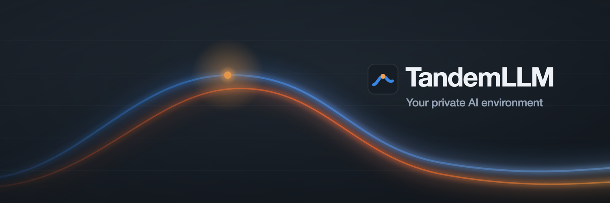

  

<h1 align="center">TandemLLM</h1>

  <b>Your private AI environment.</b> Fast local inference on your own hardware, and one dashboard in front of every model you run.

  
  
  
  

  <a href="https://tandemllm.0xbakeer.com">Website</a> ·
  <a href="https://tandemengine.0xbakeer.com">Engine docs</a> ·
  <a href="https://tandemapp.0xbakeer.com">App docs</a> ·
  <a href="https://huggingface.co/0xBakeer">Weights on Hugging Face</a> ·
  <a href="https://doi.org/10.5281/zenodo.23045275">StairCut paper</a>

## The projects

| | |
|-|-|
| **[TandemEngine](https://github.com/TandemLLM/TandemEngine)** [docs](https://tandemengine.0xbakeer.com) | The inference engine for one NVIDIA DGX Spark. Small drafters guess the next tokens and the big model checks every guess in one pass, so a right guess is a free token. On Qwen3.8-27B NVFP4 it writes about 50 tokens a second for one request, and the text is the model's own greedy text. OpenAI-compatible API. |
| **[TandemApp](https://github.com/TandemLLM/TandemApp)** [docs](https://tandemapp.0xbakeer.com) | One address and one dashboard in front of TandemEngine and any OpenAI-compatible server or cloud API. It runs Chat and the fleet of machines, counts every token, and gives each client an API key that names the backends and models it may run. |

## Support

TandemLLM is free and open source. If it saves you time or money, you can help keep it going:

- [Buy me a coffee on Ko-fi](https://ko-fi.com/0xbakeer)
- [Sponsor on GitHub](https://github.com/sponsors/0xBakeer)
- Follow [@TandemLLM](https://x.com/TandemLLM) for releases and [@0xBakeer](https://x.com/0xBakeer) for the work behind them

## Enterprise

Want TandemLLM running for your team on your own hardware, with support and a commercial license for use outside the AGPL? Write to [mail@0xbakeer.com](mailto:mail@0xbakeer.com).
